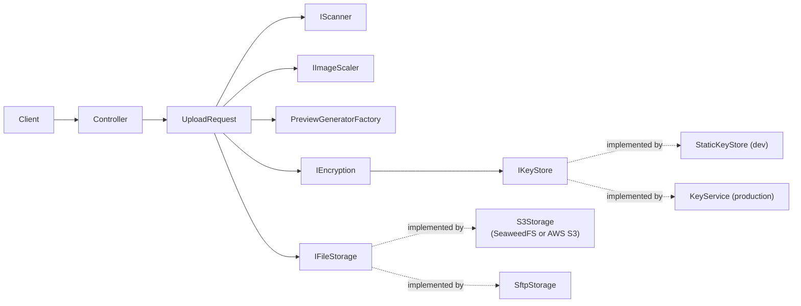

# secure-upload-server-ts-di

An encrypted file upload server in TypeScript, built to practice dependency injection.

A small HTTP server built with **Express** and **TypeScript** to practice **dependency injection** and clean architecture. Its core feature is uploading files: each file is scanned, scaled, previewed, **encrypted per user** and stored in an S3-compatible bucket or on an SFTP server. Every piece sits behind an interface, so you can swap implementations without touching business code.

> This is a learning project. It is not hardened for production use.

## What it does

An upload goes through a fixed pipeline (`UploadRequest`):

1. **Scan** the file for threats (`IScanner`)
2. **Scale** images down to a maximum width (`IImageScaler`)
3. **Generate a preview** chosen by MIME type (`PreviewGeneratorFactory`)
4. **Encrypt** the file and its preview with AES-256-GCM, using a key derived for the user (`IEncryption`)
5. **Store** the encrypted files in S3 or SFTP (`IFileStorage`)
6. **Clean up** every temporary file, on success and on failure

## Architecture



### How dependency injection is used

- **Constructor injection.** Classes receive their collaborators as constructor arguments and never create them. `UploadRequest` doesn't import `@aws-sdk`, `sharp` or `ssh2`.
- **Interfaces, prefixed with `I`.** `IFileStorage`, `IEncryption`, `IKeyStore`, `IImageScaler`, `IScanner`.
- **Composition root.** `composition-root.ts` is the only place that builds the object graph and picks implementations.
- **Factories decide from configuration.** `StorageFactory`, the scanner and key store factories read the validated environment and return the right implementation. Domain classes never read `process.env`.
- **Classes for services, functions for handlers.** Adapters, factories and use cases are classes. Controllers are factory functions that close over their dependencies (`createUploadController(deps)`).

| Interface | Implementations |
|---|---|
| `IFileStorage` | `S3Storage`, `SftpStorage` |
| `IEncryption` | `AesEncryption` |
| `IKeyStore` | `StaticKeyStore` (development), `KeyService` (production) |
| `IImageScaler` | `SharpImageScaler` |
| `IScanner` | development stubs (a real adapter is on the roadmap) |
| Preview generators | image, document, video, audio |

## Tech stack

Node.js 22, TypeScript, Express 5, Multer, `sharp`, AWS SDK v3 (`@aws-sdk/client-s3`, `@aws-sdk/lib-storage`), `ssh2-sftp-client`, `zod` (environment validation), Vitest, pnpm, Docker Compose.

## Quick start (everything in Docker)

**Prerequisites:** Docker Desktop and Node.js 22 or newer. pnpm is selected by corepack from the `packageManager` field in `package.json`.

```bash
git clone https://github.com/<your-username>/secure-upload-server-ts-di.git
cd secure-upload-server-ts-di
pnpm install

# 1. SSH key pair for the SFTP test server (creates ./keys, which is git-ignored)
pnpm keys:ssh

# 2. Environment file
cp .env.example .env.development
pnpm keys:encryption        # prints a random key, paste it into ENCRYPTION_KEY

# 3. Start the app, S3 storage (SeaweedFS), the bucket creator and the SFTP server
pnpm docker:up
```

Check that it works:

```bash
curl http://localhost:3000/health-check

echo "hello" > sample.txt
curl -i -H "x-user-id: demo-user" \
  -F "file=@sample.txt;type=text/plain" \
  http://localhost:3000/attachments

pnpm s3:ls                  # lists the encrypted objects in the bucket
```

`S3_ACCESS_KEY` and `S3_SECRET_KEY` in `.env.development` must match the credentials in `docker/seaweedfs-s3.json`.

To use SFTP instead of S3, set `STORAGE=sftp` in `.env.development` and recreate the app container:

```bash
docker compose --env-file .env.development up -d --force-recreate app
```

## Run the app on your machine

Start only the supporting services in Docker and run the server locally:

```bash
pnpm docker:services
pnpm dev:local
```

`dev:local` loads `.env.development` and then `.env.local`. Put the values that differ outside Docker into `.env.local` (git-ignored):

```env
S3_ENDPOINT=http://localhost:8333
SFTP_HOST=localhost
SFTP_PORT=2222
SFTP_PRIVATE_KEY_PATH=./keys/id_ed25519
UPLOAD_TMP_DIR=./tmp/uploads
```

## Configuration

Environment variables are validated once at startup (`zod`). If anything is missing or invalid, the app prints the variable names and exits.

| Variable | Description |
|---|---|
| `NODE_ENV` | `development`, `production` or `test` |
| `PORT` | HTTP port (default `3000`) |
| `STORAGE` | `s3` or `sftp` (required) |
| `ENCRYPTION_KEY` | 32 random bytes, base64. Required outside production |
| `KEY_SERVICE_URL` | Key service address. Required in production |
| `MAX_UPLOAD_BYTES` | Upload size limit (default 25 MB) |
| `UPLOAD_TMP_DIR` | Temporary directory (default `/tmp/uploads`) |
| `S3_ENDPOINT` | Omit for AWS, set for SeaweedFS or another S3-compatible server |
| `S3_REGION`, `S3_BUCKET` | Region and bucket name |
| `S3_ACCESS_KEY`, `S3_SECRET_KEY` | S3 credentials |
| `S3_FORCE_PATH_STYLE` | `true` for local S3-compatible servers |
| `SFTP_HOST`, `SFTP_PORT`, `SFTP_USERNAME` | SFTP connection |
| `SFTP_PRIVATE_KEY_PATH` | Path to the private key file |
| `SFTP_REMOTE_ROOT` | Remote root directory (default `upload`) |

Environment files: `.env.example` is committed. `.env.development`, `.env.production` and `.env.local` are git-ignored. Production variables should come from the hosting environment, not from a file in the repository.

## API

| Method and path | Description |
|---|---|
| `GET /health-check` | Liveness check |
| `POST /attachments` | Upload a file. Multipart form with `file` (required) and `message_id`. Returns `{ data: { attachmentId }, error, message }` |
| `GET /attachments/:id?variant=original\|preview` | Download and decrypt a stored file |

Status codes: `200` success, `400` invalid request, `401` no user, `404` not found (also returned for a wrong user), `413` file too large, `500` failure.

**Authentication.** JWT is planned. Until then a development-only middleware reads the user from the `x-user-id` header and is disabled when `NODE_ENV=production`.

## Encryption

- **AES-256-GCM** with a random 12-byte IV per file. Stored format: `[IV][ciphertext][16-byte auth tag]`.
- The key for each user is derived from the master key with **HKDF**, so every user's files are encrypted with a different key.
- GCM authenticates the data: a wrong user or a modified file fails the check and is never returned.
- Encryption happens inside the server, before anything reaches S3 or SFTP. The storage only ever sees ciphertext.
- File names and metadata are not encrypted.

## Scripts

| Script | What it does |
|---|---|
| `pnpm dev` | Watch mode (used inside the Docker dev container) |
| `pnpm dev:local` | Watch mode with `.env.development` and `.env.local` |
| `pnpm build` / `pnpm start` | Compile to `dist/` and run it |
| `pnpm typecheck` | Type-check without emitting |
| `pnpm test` | Run the tests (Vitest) |
| `pnpm docker:up` | Build and start the full Docker stack |
| `pnpm docker:services` | Start only S3, the bucket creator and SFTP |
| `pnpm docker:down` / `pnpm docker:reset` | Stop, or stop and delete all volumes |
| `pnpm docker:logs` / `pnpm docker:shell` | Follow the app logs, open a shell in the app container |
| `pnpm s3:ls` | List objects in the bucket |
| `pnpm keys:ssh` / `pnpm keys:encryption` | Generate an SSH key pair, or an encryption key |

## Troubleshooting

- **`ERR_PNPM_IGNORED_BUILDS` during the Docker build.** `pnpm-workspace.yaml` holds the approved build scripts and must be copied into the image before `pnpm install`.
- **SFTP upload fails with `Permission denied`.** The `upload` volume must be owned by the SFTP user. The compose file has an init service for this.
- **`REMOTE HOST IDENTIFICATION HAS CHANGED` from the `sftp` command.** The SFTP container generates new host keys when it is recreated. Run `ssh-keygen -R "[localhost]:2222"`.
- **`Invalid environment configuration` at startup.** A variable is missing or invalid. The message lists the names.

## Roadmap

- [ ] Attachments table and repositories (PostgreSQL) to list files and store names and MIME types
- [ ] JWT authentication
- [ ] React frontend: login and a file browser covering both storages
- [ ] Virtual folders stored in the database
- [ ] ClamAV scanner adapter
- [ ] WebDAV storage adapter

## License

MIT. See `LICENSE`.
